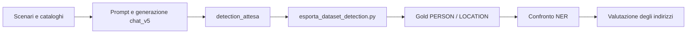
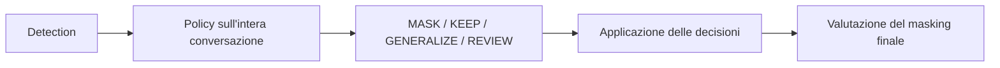

# Query anonymization per le conversazioni Istat

Il progetto sviluppa due percorsi con obiettivi e formati distinti. La
separazione è intenzionale: la V5 restringe il problema per produrre uno short
paper in tempi brevi; il percorso end-to-end estende il lavoro fino alle
decisioni contestuali e al masking finale.

## Architettura e stato

### V5: percorso dello short paper

La V5 produce chat sintetiche con detection attese costruite dal codice,
esporta un dataset pulito, valuta il riconoscimento NER di `PERSON` e
`LOCATION` e analizza in modo specifico la copertura degli indirizzi.



Questo è il perimetro sperimentale corrente. Le metriche descrivono la
detection, non il masking end-to-end.

### Percorso end-to-end

Il percorso più ampio aggiungerà la detection combinata, la policy a livello di
conversazione (`MASK`, `KEEP`, `GENERALIZE` o `REVIEW`), l’applicazione delle
decisioni e la valutazione del masking finale. Richiede annotazioni e output
con un contratto diverso da quello V5 ed è un lavoro di più lungo periodo.



Nei file e nei materiali precedenti questo percorso più ampio può essere
chiamato “Legacy” o “4.x”. In questa documentazione lo chiamiamo **percorso
end-to-end**: “Legacy” può suggerire che sia stato abbandonato, mentre è un
filone distinto ancora da completare.

Per l’ordine dei comandi, gli input e gli output di ogni passaggio, consultare
la [guida operativa della pipeline](docs/pipeline.md). In breve, il corpus
configurato si prepara, si controlla e poi si genera:

Il file dei prompt è già presente. Per rigenerarlo o creare un nuovo corpus,
assegnare percorsi di output nuovi nel file di configurazione; per usare i
prompt esistenti, saltare `prepara`.

```sh
.venv/bin/python src/pipeline_generazione.py prepara --config config/generazione_paper_300.json
.venv/bin/python src/pipeline_generazione.py controlla --config config/generazione_paper_300.json
.venv/bin/python src/pipeline_generazione.py genera --config config/generazione_paper_300.json
```

Se una generazione si interrompe per un errore di rete, riprenderla senza
ripetere le chiamate già riuscite con la fase `riprendi`:

```sh
.venv/bin/python src/pipeline_generazione.py riprendi --config config/generazione_paper_300.json
```

I due esportatori corrispondono ai due percorsi: `src/esporta_dataset_detection.py`
prepara gli input e il gold per la V5; `src/esporta_dataset_masking.py` prepara
input e annotazioni di masking per il percorso end-to-end e richiede
`chat.trattamento_atteso.mascherare`. I contratti sono diversi per scelta: la
V5 non va convertita artificialmente in annotazioni di masking, perché queste
dipendono dalle decisioni della policy conversazionale.

## File di regole

- [`config/regole_generazione.json`](config/regole_generazione.json) stabilisce
  i formati e i parametri dei valori sintetici campionati durante la
  preparazione dei prompt. Non definisce ciò che regex riconosce.
- [`config/regole_masking.json`](config/regole_masking.json) contiene pattern,
  categorie e priorità usati dal detector regex. Non genera valori né decide da
  sola se mascherarli.

La [guida della pipeline](docs/pipeline.md) descrive entrambi i percorsi, i file
prodotti dall’esportazione e la funzione delle regole; la [baseline regex](docs/baseline_regex.md)
spiega il detector regex nel dettaglio, appartenente al percorso end-to-end.
I materiali condivisibili per la scrittura dello short paper — dataset,
metodologia, modelli e risultati — sono raccolti nella cartella
[`paper/`](paper/README.md).

## Baseline corrente

Il corpus di sviluppo comprende 46 conversazioni sintetiche. Il gold NER
multilivello contiene 35 span: 20 `PERSON` e 15 `LOCATION`. Per gli indirizzi
conserva sia l'intero `ADDRESS` nel gold canonico, sia strada+civico e comune
come `LOCATION` nella vista NER.

| Modello | Precision | Recall | F1 |
|---|---:|---:|---:|
| GLiNER multilingual | 28,2% | 82,9% | 42,0% |
| GLiNER multilingual PII | 20,3% | 82,9% | 32,6% |
| WikiNEuRal | 81,6% | 88,6% | 84,9% |
| Piiranha | 93,9% | 88,6% | 91,2% |

Sono risultati esplorativi su un campione piccolo, sintetico e usato durante lo
sviluppo. Non misurano la generalizzazione su chat reali. Gli indirizzi sono un
requisito operativo prioritario: oltre all'exact match, il prossimo esperimento
dovrà misurarne anche la copertura completa dei caratteri.

## Esecuzione

Controllo locale senza scaricare modelli:

```sh
.venv/bin/python src/confronta_modelli.py --solo-controllo
```

Esecuzione su GPU:

```sh
python src/confronta_modelli.py --device cuda:0
```

La configurazione predefinita è
`config/esperimento_ner_person_location_v5_multilivello.json`. Prima di una
nuova run occorre assegnare nel file una nuova cartella `output`, perché il
runner rifiuta le sovrascritture.

Test locali:

```sh
.venv/bin/python -m unittest discover -s tests -v
```

## Struttura essenziale

- `config/`: scenari, regole, configurazione NER e piano del corpus paper;
- `data/`: cataloghi locali, inclusi i codici PSN reali;
- `src/`: generazione, esportazione, detection, merge e valutazione;
- `output/chat_v5_draft4_finale.jsonl`: corpus sintetico sorgente;
- `output/dataset_detection_v5_draft4_multilivello/`: input e gold corrente;
- `output/confronto_ner_person_location_v5_multilivello_run1/`: baseline salvata;
- `docs/`: decisioni, protocollo, risultati e istruzioni operative;
- `paper/`: materiale per la pubblicazione.

Gli esperimenti rimossi durante la pulizia restano recuperabili dalla cronologia
Git. Pesi dei modelli e credenziali non sono versionati.

## Documentazione

- [Pipeline operativa](docs/pipeline.md)
- [Decisione detection/policy](docs/decisione_architetturale_detection_policy.md)
- [Protocollo sperimentale](docs/protocollo_esperimento_detection_v5.md)
- [Risultati della baseline](docs/risultati_detection_v5_run1.md)
- [Valutazione operativa degli indirizzi](docs/valutazione_indirizzi.md)
- [Piano del dataset paper da 300 conversazioni](docs/piano_dataset_paper_300.md)
- [Confronto dei modelli](docs/confronto_modelli.md)
- [Setup Azure](docs/setup_azure.md)
- [Classificazione PSN](docs/classificazione_psn.md)
- [Regole regex](docs/baseline_regex.md)
