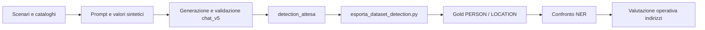
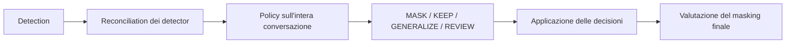

# Pipeline operativa

Questa pagina distingue i due percorsi del progetto. La V5 è il percorso sperimentale circoscritto per lo short paper; il percorso end-to-end estende il lavoro fino alle decisioni contestuali e al masking finale. I comandi vanno eseguiti dalla root della repository. Gli script rifiutano in genere di sovrascrivere output esistenti: scegliere nuovi percorsi per ogni corpus o run.

## Workflow macro: V5 per lo short paper



La V5 produce un riferimento atteso per la detection, esporta il dataset e valuta NER su `PERSON` e `LOCATION`, con un’analisi specifica degli indirizzi. Questo è il perimetro dello short paper: misura la detection, non il masking finale.

## Workflow macro: percorso end-to-end



Questo percorso richiede decisioni e annotazioni di masking, che il gold V5 di
detection non contiene. Alcuni componenti sono presenti nel repository, ma la
pipeline end-to-end non è ancora completata. Nei materiali precedenti può essere
chiamata “Legacy” o “4.x”; qui usiamo **percorso end-to-end**, perché descrive
il suo obiettivo senza suggerire che sia stato abbandonato. I due percorsi non
sono fasi consecutive dello stesso esperimento e non è previsto convertire
automaticamente il gold V5 in decisioni di masking. I testi delle chat possono
essere riutilizzati quando compatibili; cambia il gold richiesto e la domanda
che viene valutata.

## V5 dettagliata: da prompt a chat

Per il corpus paper già configurato, `pipeline_generazione.py` orchestra
preparazione, controllo e generazione:

Il file prompt configurato è già presente nel repository. Per preparare un
nuovo corpus, copiare/modificare `config/generazione_paper_300.json` assegnando percorsi
nuovi a `prompts` e `output`; tutti gli script proteggono i risultati esistenti.
Per lavorare sul file prompt già preparato, saltare `prepara` ed eseguire
`controlla` e poi `genera`.

```sh
.venv/bin/python src/pipeline_generazione.py prepara --config config/generazione_paper_300.json
.venv/bin/python src/pipeline_generazione.py controlla --config config/generazione_paper_300.json
.venv/bin/python src/pipeline_generazione.py genera --config config/generazione_paper_300.json
```

Le fasi sono distinte e vanno eseguite in quest’ordine:

1. **Prepara** (`src/genera_prompt.py`): legge `config/scenari.json`, il piano del corpus e i cataloghi locali in `data/`; campiona date, indagini e valori sintetici; scrive i prompt JSONL. Registra seed, versioni e hash delle fonti. Non chiama un modello.
2. **Controlla** (`src/esegui_generazione.py --solo-controllo`): verifica che il file prompt abbia numero di record, seed e versione previsti e che gli hash di scenari, regole, piano e cataloghi coincidano con le sorgenti correnti; mostra quindi quante risposte possono essere riutilizzate e quante nuove chiamate servirebbero. Non chiama API e non scrive il corpus.
3. **Genera** (`src/esegui_generazione.py`, che invoca `src/genera_chat.py`): riusa solo risposte precedenti compatibili; chiama il deployment per i prompt mancanti; valida localmente JSON, ruoli, slot e vincoli; salva risposte e stati di validazione. Le credenziali sono lette dall’ambiente o da `.env`; non vanno inserite nei file di configurazione.
4. **Riprendi**: dopo un’interruzione di rete, verifica il piano originale e riusa le risposte già riuscite; ritenta gli errori API e genera soltanto gli ID mancanti. Ogni tentativo viene salvato in un segmento numerato distinto.

Durante la generazione ogni richiesta mostra anche l’avanzamento globale nel
formato `[completate/totale]`, mantenendo il totale dell’intero corpus anche
dopo una ripresa.

```sh
.venv/bin/python src/pipeline_generazione.py riprendi --config config/generazione_paper_300.json
```

Output configurati per questo corpus:

- `output/prompts_paper_300.jsonl`: prompt completi, schede, valori proposti e provenienza;
- `output/generazione_paper_300/conversazioni.jsonl`: record generati, con prompt, risposta originale, chat concretizzata e stato di validazione;
- nella cartella della generazione, `piano.json`, `prompts_mancanti.jsonl` e `chat_riutilizzate.jsonl` documentano come è stato composto il risultato; `chat_nuove.jsonl` è presente se sono state necessarie nuove chiamate.

Una chat con errore API o stato `da_verificare` non va trattata come valida. `src/rivalida_chat.py` ricalcola la validazione dalle risposte originali senza nuove chiamate API; è utile dopo una modifica ai controlli, ma non sostituisce la revisione qualitativa. La validazione automatica controlla forma, slot e alcuni segnali espliciti, non certifica la correttezza semantica del dialogo.

### Esportazione del dataset V5

Il corpus v5 viene esportato con `src/esporta_dataset_detection.py`:

```sh
.venv/bin/python src/esporta_dataset_detection.py \
  --input output/chat_v5_draft4_finale.jsonl \
  --output output/dataset_detection_v5_NOME_RUN \
  --comuni data/codici_comuni.csv
```

Il dataset della baseline esiste già in `output/dataset_detection_v5_draft4_multilivello/`. Per una nuova esportazione usare una cartella nuova e aggiornare di conseguenza l’input della configurazione NER.

L’esportatore legge le chat valide, verifica testi e span, crea ID legati all’hash della fonte e separa i testi dalle annotazioni attese. Il catalogo dei comuni abilita la scomposizione multilivello degli indirizzi. Gli output sono:

- `input.jsonl`: ID tecnico, ruoli e testi da passare ai modelli NER;
- `detections_attese.jsonl`: gold canonico con fonti e possibili span annidati;
- `annotazioni_ner_attese.jsonl`: vista NER limitata a `PERSON` e `LOCATION`;
- `annotazioni_attese.jsonl`: adattatore piatto per il valutatore;
- `provenienza.jsonl`: fonte, record, stato e segnalazioni di revisione;
- `esclusi.jsonl`: record non validi o non convertibili con il motivo;
- `manifest.json`: hash delle fonti, conteggi, categorie e note d’uso.

Gli input dei detector contengono soltanto la conversazione: prompt, risposta del modello generativo, metadati e gold restano fuori. Il gold è un riferimento di sviluppo costruito da slot e riferimenti controllati, non un gold umano approvato.

### Confronto NER V5

La run NER usa `config/esperimento_ner_person_location_v5_multilivello.json`:

```sh
.venv/bin/python src/confronta_modelli.py --solo-controllo
python src/confronta_modelli.py --device cuda:0
```

Per una nuova run NER, cambiare prima il percorso `output` nel file di configurazione. La valutazione operativa degli indirizzi è un passaggio successivo sulle stesse predizioni, descritto in [valutazione_indirizzi.md](valutazione_indirizzi.md).

### Ramo regex del percorso end-to-end

Il ramo regex individua span strutturati sul testo originale e si esegue
separatamente dal confronto NER:

```sh
.venv/bin/python src/predici_regex.py \
  --input output/dataset_detection_v5_NOME_RUN/input.jsonl \
  --output output/predizioni_regex_NOME_RUN
```

Il formato `input.jsonl` contiene solo la conversazione ed è leggibile da entrambi i detector: il comando usa il dataset V5 come sorgente testuale, ma la predizione regex resta fuori dal benchmark dello short paper. I due rami producono risultati separati. `merge_detection` unisce soltanto risultati con stesso campo, offset e tipo; conserva la provenienza delle detection coincidenti e non cancella sovrapposizioni o conflitti. La funzione è disponibile, ma il flusso operativo completo NER+regex e i successivi passaggi di policy, trasformazione e valutazione finale sono ancora da completare.

## Componenti del percorso end-to-end

`src/esporta_dataset_masking.py` prepara due file allineati per record: `input.jsonl` (chat) e `annotazioni_attese.jsonl` (span da mascherare), oltre a `provenienza.jsonl`, `esclusi.jsonl` e `manifest.json`. Esempio:

```sh
.venv/bin/python src/esporta_dataset_masking.py \
  --input percorso/chat_con_annotazioni.jsonl \
  --output output/dataset_masking_NOME_RUN
```

Si possono passare più fonti ripetendo `--input`; le revisioni qualitative, quando disponibili, si passano ripetendo `--revisione`. Per ogni record l’esportatore:

1. calcola SHA-256 della fonte e forma un ID stabile come `hash_sorgente:id_originale`, così ID uguali in file diversi non collidono;
2. esclude i record con stato diverso da `valido`, riportando il motivo;
3. copia ruoli e testi della conversazione nell’input, senza descrizione, prompt, decisioni o altre annotazioni;
4. controlla che ogni annotazione da mascherare punti a un messaggio esistente, che offset e testo coincidano e che gli span non si sovrappongano;
5. omette le annotazioni fuori dialogo (descrizione e trattamento) e ne conta il numero nel manifest;
6. collega, se fornite, le segnalazioni di revisione al record tramite hash della fonte e ID originale.

Il file atteso conserva per ogni span campo, offset, tipo, ID di entità e forma, testo e sostituzione. Il manifest riporta hash delle fonti, record letti, esportati ed esclusi, conteggi per categoria e stato della revisione qualitativa. Il controllo strutturale non approva il contenuto delle annotazioni.

L’esportatore richiede che il record contenga `chat.trattamento_atteso.mascherare`. Il generatore V5 produce chat con gold per detection e non quel campo: i contratti distinti sono intenzionali. La conversione da detection a decisioni di masking non è automatica, perché dipende dalla policy a livello di conversazione. Questo esportatore serve al percorso end-to-end quando le relative annotazioni sono disponibili.

## File di regole

I due file hanno funzioni diverse e non sono alternative:

- [`config/regole_generazione.json`](../config/regole_generazione.json) è consumato da `genera_prompt.py` / `genera_valori.py`. Definisce come campionare i valori sintetici da inserire nei prompt, per esempio formati e lunghezze di telefono, password, codice utente e numero pratica. Versione e contenuto vengono registrati nei prompt per la riproducibilità. Non determina che cosa il detector riconoscerà.
- [`config/regole_masking.json`](../config/regole_masking.json) è consumato da `predici_regex.py`, componente del percorso end-to-end. Contiene pattern, tipi e priorità per riconoscere span strutturati nel testo. Non genera valori e non applica da sola una decisione di masking. Versione e hash vengono registrati nel manifest delle predizioni.

Quando si cambia un file, usare una nuova cartella di output e conservare la versione/hash associati al risultato. Regole regex e formati generativi possono evolvere separatamente: modificare uno non aggiorna automaticamente l’altro.

## Documenti collegati

- [Decisione architetturale: detection e policy](decisione_architetturale_detection_policy.md)
- [Protocollo dell’esperimento detection](protocollo_esperimento_detection_v5.md)
- [Risultati baseline](risultati_detection_v5_run1.md)
- [Ramo regex](baseline_regex.md)
- [Valutazione operativa degli indirizzi](valutazione_indirizzi.md)
- [Piano dataset paper da 300 conversazioni](piano_dataset_paper_300.md)
